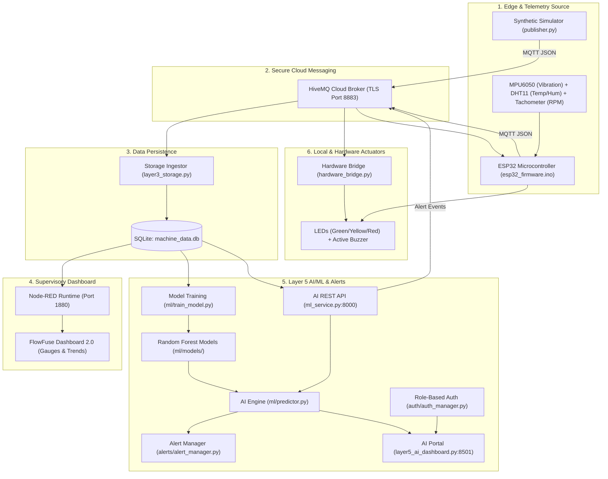

# Predictive Maintenance for Rotating Machinery Using IoT Data

An end-to-end industrial IoT predictive maintenance pipeline designed for rotating machinery assets (e.g., induction motors, gearboxes, pumps). The system progresses from edge telemetry acquisition and cloud MQTT broker streaming, to database persistence, Node-RED supervisory monitoring, AI/ML condition classification & RUL estimation, automated alerting, and physical actuator indicators.

---

## Architecture Overview



---

## Layer-by-Layer Roadmap & Status

| Layer | Focus | Technology Stack | Status |
|:---:|:---|:---|:---:|
| **Layer 1** | Synthetic Telemetry & CSV Logging | Python, Paho MQTT, CSV, Streamlit | ✅ Complete |
| **Layer 2** | Cloud Broker Direct Memory Streaming | Python `deque`, HiveMQ Cloud TLS, Streamlit | ✅ Complete |
| **Layer 3** | Persistent Database Storage | SQLite, Paho MQTT subscriber, Query engine | ✅ Complete |
| **Layer 4** | Supervisory Monitoring & Flow Dashboard | Node-RED, SQLite node, FlowFuse Dashboard 2.0 | ✅ Complete |
| **Layer 5** | AI/ML Diagnostics, RUL, Auth & Alerts | Scikit-learn, Random Forest, Python HTTP/REST, Streamlit | ✅ Complete |
| **Layer 6** | Real Sensor Firmware & Actuators | ESP32 (C++), MPU-6050, DHT11, Tachometer, LEDs, Buzzer | 🟡 Prototype Ready (Hardware Validation Pending) |

---

## Machine Learning Capabilities (Layer 5)

> **Evaluation Note:** The reported metrics below were evaluated on the project's generated synthetic dataset. Because synthetic labels and RUL targets follow programmed degradation patterns, these figures reflect prototype algorithmic verification rather than real-world predictive accuracy. Validation on physical rotating machinery with real sensor data is still required before operational deployment.

- **Condition Classifier:** `RandomForestClassifier` trained on machine operating telemetry with **100% test accuracy** (measured on synthetic benchmark split).
- **Remaining Useful Life (RUL) Regressor:** `RandomForestRegressor` with **R² = 0.9968** (measured on synthetic benchmark split).
- **Failure Risk Meter:** Dynamic probability index ($0.0\%$ to $100.0\%$).
- **Anomaly Score:** Multi-variate deviation index from nominal operation baseline ($0$ to $100$).
- **Root-Cause Diagnostics:** Identifies specific mechanical degradation signatures:
  - Bearing raceway fatigue & angular misalignment (vibration $> 0.20\text{ g}$)
  - Motor thermal overload & cooling failure (temperature $> 60^\circ\text{C}$ & load $> 75\%$)
  - Mechanical looseness / unbalance (vibration $0.08 - 0.20\text{ g}$)
  - Under-speed drag & stall (RPM $< 1350$)
- **Prescriptive Action Checklist:** Step-by-step guidance for reliability engineers.

---

## User Authentication & Roles

Pre-configured accounts with salted SHA-256 password security:

| Role | Username | Password | Permissions |
|:---|:---|:---|:---|
| **Admin** | `admin` | `admin123` | Full system access, model retraining, user management, alert resolution |
| **Engineer** | `engineer` | `engineer123` | Predictive diagnostics, prescriptive maintenance, alert resolution |
| **Operator** | `operator` | `operator123` | Live telemetry monitoring, status view, alert acknowledgment |

---

## Repository Structure

```text
HCL-Predictive-Maintenance/
├── files/
│   └── HCL_Predictive_Maintenance_Progress.md  # Detailed project progress document
├── flows/
│   └── node_red_flow.json                      # Exported complete Node-RED flow
├── ml/
│   ├── models/                                 # Trained serialized models & metrics
│   │   ├── condition_classifier.joblib
│   │   ├── rul_regressor.joblib
│   │   ├── scaler.joblib
│   │   └── model_metrics.json
│   ├── train_model.py                          # Model training script
│   └── predictor.py                            # AI inference & diagnostic engine
├── alerts/
│   └── alert_manager.py                        # Persistent SQLite alert manager
├── auth/
│   └── auth_manager.py                         # Role-based user authentication
├── hardware/
│   ├── esp32_firmware.ino                      # ESP32 C++ firmware for real sensors
│   ├── hardware_bridge.py                      # Virtual & physical GPIO actuator bridge
│   └── circuit_diagram.md                      # Pinouts, schematic, and BOM
├── data/
│   ├── machine_data.db                         # SQLite telemetry and alerts database
│   └── machine_data.csv                        # CSV dataset
├── publisher.py                                # Synthetic telemetry generator (Layer 1-3)
├── subscriber.py                               # CSV subscriber (Layer 1)
├── layer3_storage.py                           # SQLite storage worker (Layer 3)
├── ml_service.py                               # Layer 5 AI REST API and alert publisher
├── layer5_ai_dashboard.py                      # Layer 5 Streamlit AI Dashboard
├── dashboard.py                                # Layer 1 Streamlit dashboard
├── layer2_dashboard.py                         # Layer 2 direct MQTT dashboard
├── layer3_dashboard.py                         # Layer 3 SQLite dashboard
├── requirements.txt                            # Python dependencies
└── README.md                                   # Project documentation
```

---

## Quickstart Guide

### 1. Environment Setup
```powershell
python -m venv .venv
.\.venv\Scripts\activate
pip install -r requirements.txt
```

Ensure `.env` contains your HiveMQ credentials and matches the active telemetry topic used by `publisher.py`, `layer3_storage.py`, and `esp32_firmware.ino`:
```env
HIVEMQ_HOST=your-cluster-id.s1.eu.hivemq.cloud
HIVEMQ_PORT=8883
HIVEMQ_USERNAME=your_username
HIVEMQ_PASSWORD=your_password
MQTT_TOPIC=hcl/predictive-maintenance/motor01/data
```
*(Note: Your local `.env` defines the runtime broker credentials and must configure `MQTT_TOPIC` to match the topic subscribed by `layer3_storage.py` and published by the edge components).*

### 2. Retrain Machine Learning Models (Optional)
```powershell
python ml/train_model.py
```

### 3. Start Telemetry Publisher & Storage Worker
```powershell
# Terminal 1
python publisher.py

# Terminal 2
python layer3_storage.py
```

### 4. Launch Layer 5 AI Service
```powershell
# Terminal 3
python ml_service.py
```

### 5. Launch Layer 5 Streamlit Predictive AI Portal
```powershell
# Terminal 4
streamlit run layer5_ai_dashboard.py
```
Access the AI Dashboard at: `http://localhost:8501`

### 6. Node-RED Supervisory Dashboard (Layer 4)
```powershell
# Terminal 5
node-red
```
Access Node-RED Dashboard: `http://localhost:1880/dashboard/predictive-maintenance`

> **Flow Configuration Note:**
> - `flows/node_red_flow.json` is the **canonical** exported flow (contains complete FlowFuse Dashboard 2.0 configuration, SQLite query, gauges, and historical trends).
> - The embedded SQLite configuration node references `machine_data.db`. If moving the project folder or importing onto a new machine, edit the SQLite config node in Node-RED to point to the local database file path before clicking **Deploy**.

### 7. Run Hardware Actuator Bridge (Layer 6)
```powershell
# Terminal 6
python hardware/hardware_bridge.py
```
Simulates/controls GPIO Pin 18 (Green LED), Pin 19 (Yellow LED), Pin 5 (Red LED), and Pin 23 (Audible Buzzer alarm via PC speaker).
