# Layer 6 Hardware Integration — Schematic, Pinout & Bill of Materials

## 1. System Overview

Layer 6 transitions the predictive maintenance pipeline from purely synthetic data to physical edge hardware.

An **ESP32 microcontroller** interfaces with physical sensors to capture vibration, temperature, humidity, and rotational speed (RPM). The ESP32 formats the readings into JSON and publishes them directly to **HiveMQ Cloud MQTT** over TLS (Port 8883).

In addition, physical actuators (Tri-color LEDs and an Active Buzzer) are connected to the ESP32 to provide immediate local visual and acoustic warnings whenever the cloud AI or edge logic detects machine anomalies.

---

## 2. Bill of Materials (BOM)

| Item | Component | Specification | Quantity | Role |
|:---:|:---|:---|:---:|:---|
| 1 | **ESP32 DevKit V1** | 30-pin Dual-Core Tensilica Xtensa 32-bit, WiFi + BLE | 1 | Edge MCU & MQTT Client |
| 2 | **MPU-6050** | 3-axis Accelerometer + 3-axis Gyroscope (I2C) | 1 | Machinery Vibration Sensing |
| 3 | **DHT11 / DHT22** | Digital Temperature & Humidity Sensor | 1 | Ambient & Bearing Thermal Sensing |
| 4 | **Optical / Hall Sensor** | LM393 Speed Sensor module with slotted disc / magnet | 1 | Shaft Rotational Speed (RPM) |
| 5 | **Green LED (5mm)** | 2.0V forward, 20mA | 1 | Healthy Indicator (GPIO 18) |
| 6 | **Yellow LED (5mm)**| 2.1V forward, 20mA | 1 | Warning Indicator (GPIO 19) |
| 7 | **Red LED (5mm)**   | 2.0V forward, 20mA | 1 | Fault / Emergency Indicator (GPIO 21) |
| 8 | **Active Buzzer**   | 5V / 3.3V DC piezo active buzzer | 1 | Acoustic Alarm (GPIO 22) |
| 9 | **Resistors**       | 220 Ω (LEDs), 4.7 kΩ (DHT pull-up) | 4 | Current limiting & Bus pull-up |
| 10| **Breadboard / PCB**| Half/Full-size solderless breadboard + jumper wires | 1 | Prototyping interconnect |

---

## 3. ESP32 Pin Assignment & Wiring Table

| ESP32 Pin | Connected Device | Device Pin | Signal Type | Description |
|:---|:---|:---|:---|:---|
| **3V3** | MPU-6050, DHT11, LEDs | VCC | Power | 3.3V DC Power Bus |
| **GND** | All Sensors & Actuators | GND | Ground | Common Ground Rail |
| **GPIO 21** | MPU-6050 | SDA | I2C Data | Vibration Acceleration Telemetry |
| **GPIO 22** | MPU-6050 | SCL | I2C Clock | I2C Bus Clock |
| **GPIO 4** | DHT11 / DHT22 | DATA (OUT) | Digital 1-Wire | Temperature & Humidity with 4.7kΩ pull-up |
| **GPIO 13** | Optical / Hall Tachometer | D0 (OUT) | Digital Interrupt | Hardware interrupt on falling edge for RPM |
| **GPIO 18** | Green Status LED | Anode (+) | Digital Output | High = Healthy Status (via 220Ω resistor) |
| **GPIO 19** | Yellow Status LED| Anode (+) | Digital Output | High = Warning Status (via 220Ω resistor) |
| **GPIO 21\***| Red Status LED   | Anode (+) | Digital Output | High = Fault Status (via 220Ω resistor) |
| **GPIO 23** | Active Buzzer    | (+) Terminal| Digital Output| High = Alarm Active, Low = Silent |

*\*Note: When using GPIO 21 for I2C SDA, the Red LED is wired to GPIO 5 or GPIO 27 to avoid I2C conflict.*

---

## 4. Hardware Wiring Diagram (Mermaid)

```mermaid
graph TD
    subgraph ESP32_Microcontroller ["ESP32 Microcontroller (30-Pin)"]
        3V3["3.3V Rail"]
        GND["GND Rail"]
        P21["GPIO 21 (SDA)"]
        P22["GPIO 22 (SCL)"]
        P4["GPIO 4 (1-Wire)"]
        P13["GPIO 13 (INT)"]
        P18["GPIO 18 (OUT)"]
        P19["GPIO 19 (OUT)"]
        P5["GPIO 5 (OUT)"]
        P23["GPIO 23 (OUT)"]
    end

    subgraph Sensors ["Sensors"]
        MPU["MPU-6050 Vibration Sensor"]
        DHT["DHT11 Thermal Sensor"]
        TACH["Hall / Optical Tachometer"]
    end

    subgraph Actuators ["Local Physical Actuators"]
        LED_G["Green LED (Healthy)"]
        LED_Y["Yellow LED (Warning)"]
        LED_R["Red LED (Fault)"]
        BUZZ["Active Piezo Buzzer"]
    end

    subgraph Cloud ["IoT Pipeline"]
        HIVEMQ["HiveMQ Cloud (TLS 8883)"]
        SQLITE["SQLite Database"]
        NODERED["Node-RED Dashboard"]
        AI["Layer 5 AI Engine"]
    end

    3V3 -->|Power| MPU
    3V3 -->|Power| DHT
    3V3 -->|Power| TACH
    GND -->|Ground| MPU
    GND -->|Ground| DHT
    GND -->|Ground| TACH
    GND -->|Ground| LED_G
    GND -->|Ground| LED_Y
    GND -->|Ground| LED_R
    GND -->|Ground| BUZZ

    P21 -->|I2C SDA| MPU
    P22 -->|I2C SCL| MPU
    P4 -->|DATA| DHT
    P13 -->|PULSE| TACH

    P18 -->|220 ohm| LED_G
    P19 -->|220 ohm| LED_Y
    P5 -->|220 ohm| LED_R
    P23 -->|Signal| BUZZ

    ESP32_Microcontroller -->|MQTT Telemetry| HIVEMQ
    HIVEMQ --> SQLITE
    SQLITE --> NODERED
    SQLITE --> AI
    AI -->|Alert Commands| HIVEMQ
    HIVEMQ -->|MQTT Command| ESP32_Microcontroller
```

---

## 5. Vibration (RMS) Calculation Formula

In rotating machinery standards (ISO 10816), vibration severity is evaluated using **Root Mean Square (RMS)** velocity or acceleration:

$$g_{RMS} = \sqrt{\frac{1}{N}\sum_{i=1}^{N} \left(\sqrt{a_{x,i}^2 + a_{y,i}^2 + a_{z,i}^2} - g_0\right)^2}$$

Where:
- $a_x, a_y, a_z$ are the three orthogonal acceleration axes in $g$ sampled from the MPU-6050.
- $g_0 = 1.0\text{ g}$ represents static gravitational acceleration subtracted from dynamic acceleration.
- $N$ is the sample window size (25 samples per calculation).

---

## 6. How to Flash the Firmware to ESP32

1. Open **Arduino IDE** (or VS Code with PlatformIO).
2. Install the **ESP32 Board Package** via Boards Manager.
3. Install required libraries from Library Manager:
   - `PubSubClient` by Nick O'Leary
   - `DHT sensor library` by Adafruit
   - `ArduinoJson` by Benoit Blanchon (v6 or v7)
4. Open [hardware/esp32_firmware.ino](file:///c:/Users/devdw/OneDrive/Documents/HCL-Predictive-Maintenance/hardware/esp32_firmware.ino).
5. Update your Wi-Fi SSID, Password, and HiveMQ credentials from your `.env` file.
6. Connect ESP32 via Micro-USB, select board **ESP32 Dev Module**, choose COM Port, and click **Upload**.
7. Open Serial Monitor at **115200 baud** to view live telemetry and TLS connection logs.
