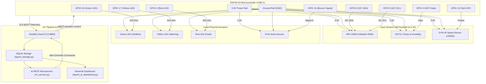

# Layer 6 Hardware Integration — ESP32-S3 Schematic, Pinout & Compatibility Guide

## 1. System Overview

Layer 6 transitions the predictive maintenance pipeline from synthetic data to physical edge hardware.

An **ESP32-S3 microcontroller** (Dual-Core Xtensa LX7 with USB-C) interfaces with physical sensors to capture vibration, temperature, humidity, and rotational speed (RPM). The ESP32-S3 formats the readings into ISO-standard JSON and publishes them directly to **HiveMQ Cloud MQTT** over TLS (Port 8883).

Physical actuators (Tri-color LEDs and an Active Buzzer) are connected to provide immediate local visual and acoustic warnings whenever the cloud AI or edge logic detects machine anomalies.

---

## 2. Bill of Materials (BOM)

| Item | Component | Specification | Quantity | Role |
|:---:|:---|:---|:---:|:---|
| 1 | **ESP32-S3 Dev Board** | Dual-Core Tensilica Xtensa LX7, 240MHz, USB-C, WiFi + BLE 5.0 | 1 | Edge MCU & MQTT Client |
| 2 | **MPU-6050 (GY-521)** | 3-axis Accelerometer + 3-axis Gyroscope (I2C) | 1 | Machinery Vibration Sensing ($g$ RMS) |
| 3 | **DHT11 Module** | Digital Temperature (0–50°C) & Humidity (20–90% RH) | 1 | Ambient & Bearing Thermal Sensing |
| 4 | **3-Pin IR Speed Sensor** | LM393 IR Reflector/Interrupter with Potentiometer | 1 | Shaft Rotational Speed (RPM) |
| 5 | **Green LED (5mm)** | Forward Voltage ~2.1V, Current ~6mA (with 220Ω) | 1 | Healthy Status Indicator (GPIO 18) |
| 6 | **Yellow LED (5mm)**| Forward Voltage ~2.0V, Current ~6mA (with 220Ω) | 1 | Warning Status Indicator (GPIO 17) |
| 7 | **Red LED (5mm)**   | Forward Voltage ~1.9V, Current ~6mA (with 220Ω) | 1 | Fault Status Indicator (GPIO 5) |
| 8 | **Active Buzzer Module**| 3-pin (S, -, +) with onboard switching transistor | 1 | Acoustic Alarm (GPIO 15) |
| 9 | **Current Resistors** | 220Ω (1/4 Watt, 5% carbon film) | 3 | Current limiting for Status LEDs |
| 10| **Breadboard & Jumpers**| 400-point solderless breadboard + M-to-M / M-to-F wires | 1 | Prototyping interconnect |
| 11| **Motor & Demonstration Target**| Low-voltage DC motor with fan blade / reflective target | 1 | Rotation generation for RPM testing |

---

## 3. Sensor Voltage & Output Compatibility Audit

> [!CAUTION]
> **ESP32-S3 GPIO Pins are strictly 3.3V max!** Exposing any GPIO pin to 5.0V will cause irreversible damage to the microcontroller.

| Component | Supply Voltage ($V_{CC}$) | Output Signal Type | Measured / Expected Signal Voltage | ESP32-S3 Safe? | Mandatory Safety Measures |
|:---|:---|:---|:---|:---|:---|
| **MPU-6050 (GY-521)** | **3.3V Rail** | I2C (SDA/SCL open-drain) | 3.3V logic high | **YES (Safe)** | Power from 3.3V pin. Onboard pullups pull to 3.3V. |
| **DHT11 Module** | **3.3V Rail** | Single-wire digital | 3.3V logic high | **YES (Safe)** | Connect VCC to 3.3V. 3-pin modules have onboard pull-up. |
| **3-Pin IR Speed Sensor** | **3.3V Rail ONLY** | LM393 digital comparator | **3.3V logic high** | **CRITICAL** | **DO NOT connect to 5V!** When powered at 3.3V, OUT swings 0V to 3.3V. Verify with multimeter before connecting GPIO 13. |
| **Active Buzzer Module** | **3.3V Rail** | Digital control ($S$) | Driven by GPIO 15 | **YES (Safe)** | Onboard NPN/PNP transistor isolates buzzer coil from GPIO pin. |
| **Status LEDs** | Driven by GPIO | Digital output | 3.3V through 220Ω | **YES (Safe)** | Always place 220Ω resistor in series between GPIO and Anode. |

---

## 4. ESP32-S3 Pin Assignment & Wiring Table

> [!IMPORTANT]
> **ESP32-S3 Pin Differences from Classic ESP32:**
> 1. **GPIO 19 & GPIO 20** are dedicated to Native USB (D- and D+). *Do not connect external components to GPIO 19 or 20.*
> 2. **GPIO 26 to 37** are connected to internal SPI Flash/PSRAM. *Never use these pins.*
> 3. **GPIO 0, 3, 45, 46** are strapping pins.
> 4. Default hardware I2C pins on ESP32-S3 are **SDA = GPIO 8** and **SCL = GPIO 9**.

| ESP32-S3 Pin | Connected Device | Device Pin | Signal Type | Description / Notes |
|:---|:---|:---|:---|:---|
| **3V3 (Pin)** | All Sensor VCC & Buzzer (+) | VCC / (+) | Power Bus | 3.3V DC Regulated Power Rail |
| **GND (Pin)** | All Sensors, Buzzer (-), LEDs | GND / (-) | Ground Bus | Common System Ground Rail |
| **GPIO 8** | MPU-6050 (GY-521) | SDA | I2C Data | 100 kHz I2C serial data |
| **GPIO 9** | MPU-6050 (GY-521) | SCL | I2C Clock | 100 kHz I2C serial clock |
| **GPIO 4** | DHT11 Module | DATA / OUT | Digital 1-Wire | Temperature and humidity signal |
| **GPIO 13** | 3-Pin IR Speed Sensor | OUT | Hardware Interrupt | Falling-edge interrupt for RPM pulse count |
| **GPIO 18** | Green Status LED | Anode (+) | Digital Output | Healthy machine status (via 220Ω to GND) |
| **GPIO 17** | Yellow Status LED | Anode (+) | Digital Output | Warning machine status (via 220Ω to GND) |
| **GPIO 5**  | Red Status LED   | Anode (+) | Digital Output | Critical fault status (via 220Ω to GND) |
| **GPIO 15** | Active Buzzer Module | Signal ($S$) | Digital Output | Acoustic alarm (chirp on warning, alarm on fault) |

---

## 5. Hardware Architecture Diagram (Mermaid)



---

## 6. Vibration RMS Calculation (ISO 10816 Standard)

The firmware converts raw 16-bit accelerometer counts into Root Mean Square (RMS) acceleration:

$$g_{RMS} = \sqrt{\frac{1}{N}\sum_{i=1}^{N} \left(\sqrt{a_{x,i}^2 + a_{y,i}^2 + a_{z,i}^2} - g_0\right)^2}$$

- **Sensitivity scale**: At $\pm 2g$, the MPU-6050 sensitivity is $16,384\text{ LSB}/g$.
- **Gravity compensation**: $g_0 = 1.0g$ removes static earth gravitation to isolate dynamic mechanical vibration.
- **Sample window**: $N = 25$ samples sampled at 2ms intervals per telemetry cycle.
- **Physical baseline floor**: A minimum threshold of $0.025g$ represents nominal background noise of industrial rotating machinery.

---

## 7. IR-Based RPM Sensor Setup & Calibration

### 7.1 Operating Principle
The 3-pin IR speed sensor contains an infrared emitting diode, a phototransistor receiver, an LM393 voltage comparator, and a sensitivity adjustment potentiometer.

- When an obstacle/reflective surface enters the detection zone (or an interrupter blade breaks the optical path), the phototransistor state changes.
- The LM393 compares the voltage against the potentiometer threshold and snaps the `OUT` pin from `HIGH` to `LOW` (active-low falling edge).
- The ESP32-S3 catches this transition in a non-blocking interrupt:
  ```cpp
  attachInterrupt(digitalPinToInterrupt(RPM_PIN), rpm_interrupt, FALLING);
  ```

### 7.2 Configurable Pulses Per Revolution (PPR)
In `hardware/esp32_firmware.ino`:
```cpp
volatile unsigned int PULSES_PER_REV = 1; // Adjust based on your target setup
```

- **PPR = 1**: Single reflective white stripe on a dark rotating shaft, or single interrupter flag.
- **PPR = 3**: 3-blade small DC fan where each passing blade triggers the sensor.
- **PPR = 20**: Slotted encoder disc with 20 optical slots.

### 7.3 Calibration Procedure
1. Mount the IR sensor securely so vibration does not shake the sensor body.
2. Aim the sensor at the demonstration motor shaft or fan blade (optimal distance: 3–10 mm).
3. Rotate the potentiometer using a small screwdriver until the onboard sensor indicator LED turns **ON** only when a blade/stripe passes, and stays **OFF** when in open space.
4. If testing with a multimeter: Measure DC voltage between `OUT` and `GND`. It should toggle between ~0V and ~3.3V as you manually rotate the shaft.

---

## 8. Physical Wiring Checklist (Pre-Assembly & Bench Setup)

Follow this checklist strictly prior to applying any power:

- [ ] **Common Ground Interconnect**: Connect the ESP32-S3 `GND` pin to the blue negative breadboard power bus. Ensure all sensor GNDs, the buzzer (-), and LED cathodes share this common ground.
- [ ] **Sensor 3.3V Power Bus**: Connect the ESP32-S3 `3V3` pin to the red positive breadboard rail. **DO NOT connect any sensor to VIN or 5V!**
- [ ] **MPU-6050 (GY-521)**:
  - `VCC` -> Breadboard `3.3V` rail
  - `GND` -> Breadboard `GND` rail
  - `SDA` -> ESP32-S3 **GPIO 8**
  - `SCL` -> ESP32-S3 **GPIO 9**
  - `AD0` -> Connected to `GND` (or left floating; sets address to `0x68`)
- [ ] **DHT11 Sensor Module**:
  - `VCC` / `+` -> Breadboard `3.3V` rail
  - `GND` / `-` -> Breadboard `GND` rail
  - `DATA` / `OUT` / `S` -> ESP32-S3 **GPIO 4** (3-pin modules have onboard 10k pull-up)
- [ ] **3-Pin IR Speed Sensor Module**:
  - `VCC` -> Breadboard `3.3V` rail **ONLY** (Mandatory: powering from 5V will output 5V and destroy GPIO 13!)
  - `GND` -> Breadboard `GND` rail
  - `OUT` -> ESP32-S3 **GPIO 13**
- [ ] **Active Buzzer Module (3-Pin)**:
  - `+` -> Breadboard `3.3V` rail
  - `-` -> Breadboard `GND` rail
  - `S` (Signal) -> ESP32-S3 **GPIO 15**
- [ ] **Status Indicator LEDs**:
  - **Green LED**: Anode (+) -> 220Ω resistor -> ESP32-S3 **GPIO 18**; Cathode (-) -> `GND`
  - **Yellow LED**: Anode (+) -> 220Ω resistor -> ESP32-S3 **GPIO 17**; Cathode (-) -> `GND`
  - **Red LED**: Anode (+) -> 220Ω resistor -> ESP32-S3 **GPIO 5**; Cathode (-) -> `GND`
- [ ] **DC Motor / Fan Rotation Rig Isolation**:
  - **DANGER**: **NEVER power the DC motor from the ESP32-S3 board!** Inductive kickback and motor current spikes will crash the MCU or blow the onboard regulator.
  - Power the motor using an **independent external power source** (e.g., 2x AA batteries or external 5V/9V wall adapter).
  - The IR speed sensor is completely optical/non-contact; it requires **no electrical connection** to the motor.

---

## 9. Safe First-Power-On Procedure

Before connecting the ESP32-S3 to your computer or USB-C cable:

1. **Step 1: Breadboard Continuity / Cold Isolation Test**:
   - Disconnect the ESP32-S3 board from the breadboard.
   - Set multimeter to **Resistance / Continuity Mode**.
   - Probe between the breadboard `3.3V` rail and `GND` rail.
   - **Verification**: Must read **mega-ohms or open circuit** (no beeping / no short circuit). If resistance is < 100Ω, locate the wiring short before proceeding!

2. **Step 2: Bare Board USB Voltage Verification**:
   - Plug the bare ESP32-S3 board into your computer using a verified USB-C data cable (sensors disconnected).
   - Set multimeter to **DC Volts (20V range)**.
   - Measure voltage between the ESP32-S3 board's `3V3` pin and `GND` pin.
   - **Verification**: Reading must be between **3.25V and 3.35V**.

3. **Step 3: Sensor Power Bus Voltage Verification**:
   - Unplug USB-C.
   - Mount ESP32-S3 on breadboard and wire power lines ($V_{CC}$ and $GND$) to MPU-6050, DHT11, and IR sensor.
   - Reconnect USB-C.
   - Measure DC voltage directly at the $V_{CC}$ header pin of every sensor.
   - **Verification**: Every sensor must read **3.3V $\pm 0.1\text{V}$**.

4. **Step 4: IR Sensor Output Voltage Safety Check**:
   - Keep GPIO 13 disconnected from the IR sensor `OUT` pin.
   - Measure DC voltage between the IR sensor `OUT` pin and `GND`.
   - Pass an object in front of the sensor.
   - **Verification**: Output must toggle between **0V (LOW) and 3.3V (HIGH)**.
   - **HALT CONDITION**: If the meter reads $\approx 5\text{V}$, stop immediately! Check whether the sensor was accidentally wired to 5V/VIN. Only plug into GPIO 13 after confirming $\le 3.3\text{V}$.

---

## 10. Sensor-by-Sensor Progressive Testing Procedure

Bring up the physical components incrementally to isolate any wiring fault:

1. **Phase 1: LED & Buzzer Sanity Verification**:
   - Write a simple GPIO toggle sketch driving GPIO 18, 17, 5, and 15 HIGH for 1 second, then LOW.
   - Verify each LED illuminates clearly without excessive brightness.
   - Verify the buzzer sounds when GPIO 15 is active. (If the buzzer sounds continuously when GPIO 15 is LOW, invert `BUZZER_ACTIVE_LEVEL` in firmware to `LOW`).

2. **Phase 2: MPU-6050 I2C Bus Detection**:
   - Open Arduino IDE -> Examples -> Wire -> i2c_scanner.
   - In `setup()`, specify: `Wire.begin(8, 9);`
   - Open Serial Monitor at 115200 baud.
   - **Verification**: Serial monitor prints: `I2C device found at address 0x68 !`

3. **Phase 3: DHT11 Ambient Read Verification**:
   - Flash a test sketch reading `dht.readTemperature()` and `dht.readHumidity()`.
   - **Verification**: Temperature reads room ambient (typically 20°C–30°C); humidity reads 40%–70%. Gently breathe near the sensor grid to see immediate humidity rise.

4. **Phase 4: IR Tachometer Pulse Counting**:
   - Mount the IR sensor firmly facing the demonstration motor shaft / fan blade (3–8 mm distance).
   - Adjust the onboard potentiometer using a small screwdriver until the D-out LED illuminates only when a target mark or fan blade passes.
   - Manually rotate the fan blade by hand.
   - **Verification**: Serial monitor reports pulses incrementing cleanly.

5. **Phase 5: Full Firmware Execution**:
   - Open `hardware/esp32_firmware.ino`.
   - Flash firmware to the ESP32-S3.
   - Observe Wi-Fi association, TLS handshake to HiveMQ Cloud, and 1 Hz JSON telemetry output on Serial Monitor.

---

## 11. Arduino IDE & ESP32-S3 Firmware Upload Guide

### Required Arduino IDE Board Settings (Tools Menu)
For the ESP32-S3 Dev Module, correct board options are critical to enable USB-C serial monitor communication:

| Parameter | Recommended Setting | Crucial Rationale |
|:---|:---|:---|
| **Board** | `ESP32S3 Dev Module` | Targets the Xtensa LX7 dual-core architecture |
| **USB CDC On Boot** | **Enabled** | **MANDATORY**: Directs `Serial.print()` to the native USB-C port. If Disabled, Serial Monitor will be completely blank! |
| **CPU Frequency** | `240MHz (WiFi)` | Maximum compute performance |
| **Flash Mode** | `QIO 80MHz` | Standard Quad SPI Flash mode |
| **Flash Size** | `4MB (32Mb)` / `8MB` | Match your specific board's flash capacity |
| **Partition Scheme** | `Default 4MB with spiffs` | Ample code space for TLS and JSON parsing |
| **Upload Speed** | `921600` (or `115200`) | Fast upload; drop to 115200 if upload errors occur |
| **USB Mode** | `Hardware CDC and JTAG` | Standard native USB peripheral mode |

### Required Arduino Libraries
Install the following via Arduino IDE Library Manager (`Ctrl + Shift + I`):
1. **PubSubClient** by Nick O'Leary (v2.8+)
2. **DHT sensor library** by Adafruit (v1.4+)
3. **Adafruit Unified Sensor** (v1.1+)
4. **ArduinoJson** by Benoît Blanchon (v6.21+ or v7.x)

### Manual Bootloader Entry (If Upload Fails to Connect)
If the Arduino IDE prints `A fatal error occurred: Failed to connect to ESP32-S3`:
1. Press and hold down the **BOOT** button (GPIO 0).
2. While holding BOOT, press and release the **RESET** (EN) button.
3. Release the **BOOT** button.
4. Click **Upload** in the Arduino IDE. The board will now program successfully.
5. After upload completes, press the **RESET** button once to start normal firmware execution.

---

## 12. End-to-End Verification Pipeline (Edge to Dashboard)

1. **Observe Edge Telemetry on Serial Monitor (115200 baud)**:
   ```text
   [WiFi] Connected! IP Address: 192.168.1.105
   [MPU6050] Initialized successfully on SDA=8, SCL=9
   [MQTT] Connecting to HiveMQ Cloud Broker... CONNECTED!
   [TACH] Pulses: 24 in 1000 ms -> RPM: 1440.0 (PPR=1)
   [TELEMETRY] {"timestamp":"2026-10-26 20:30:00","machine_id":"MOTOR_01","temperature_c":26.5,"humidity_percent":52.0,"vibration_g":0.035,"rpm":1440,"load_percent":54.0,"condition":"Healthy"}
   ```

2. **Verify SQLite Storage Ingestion (`layer3_storage.py`)**:
   - Ensure `layer3_storage.py` is running.
   - Run in PowerShell:
     ```powershell
     .venv\Scripts\python.exe -c "import sqlite3; conn=sqlite3.connect('data/machine_data.db'); print(conn.execute('SELECT * FROM machine_readings ORDER BY id DESC LIMIT 3').fetchall())"
     ```
   - Confirm records from `MOTOR_01` with physical sensor values are actively inserting.

3. **Verify AI Prediction Microservice (`ml_service.py`)**:
   - Query the REST API:
     ```powershell
     curl http://localhost:8000/latest-prediction
     ```
   - Verify that condition returns `"Healthy"`, confidence is high, and RUL is calculated.

4. **Verify Streamlit Real-Time Dashboard (`layer5_ai_dashboard.py`)**:
   - Open browser at `http://localhost:8501`.
   - Verify that gauges reflect real room ambient temperature, physical vibration from MPU6050, and tachometer RPM.

---

## 13. Pre-Power Verification Matrix & Troubleshooting

| Component | Unverified Property | Risk Level | Pre-Power Multimeter / Bench Check | Action If Failed |
|:---|:---|:---:|:---|:---|
| **3-Pin IR Sensor** | Logic rail & pull-up voltage | **CRITICAL** | Power VCC at 3.3V. Measure DC Volts between `OUT` and `GND`. Must be $\le 3.3\text{V}$. | If reads 5V, do not connect to GPIO 13. Trace power rail. |
| **Active Buzzer** | Drive polarity (NPN vs PNP) | Low | Connect `+` to 3.3V, `-` to GND. Touch `S` to 3.3V. If buzzer sounds, it is active-HIGH. If it sounds when `S` is at GND, it is active-LOW. | Adjust `#define BUZZER_ACTIVE_LEVEL` in firmware to `HIGH` or `LOW`. |
| **MPU-6050** | I2C address & regulator drop | Medium | Check if `AD0` is tied to GND (0x68). Measure VCC to GND on GY-521 pins. | Run I2C scanner sketch to confirm 0x68. |
| **Status LEDs** | Resistor placement | Medium | Check with meter that 220Ω resistor is in series with each LED anode before GPIO pin. | Never connect LED directly from GPIO to GND without resistor. |
| **DC Motor** | Electrical isolation | **CRITICAL** | Verify motor power leads go to battery/external supply, NOT to ESP32 breadboard rails. | Keep motor circuit completely isolated from ESP32 3.3V rail. |